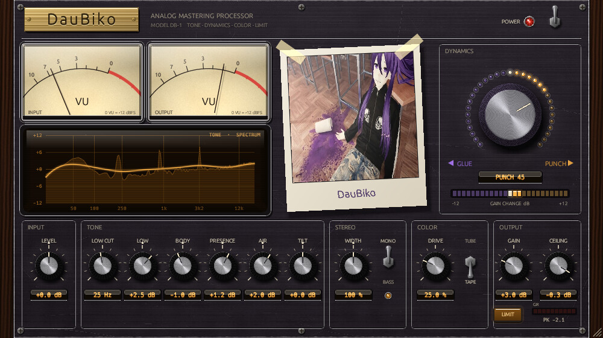

<div align="center">

# DauBiko

Analog-style mastering processor (VST3) written in Rust.

</div>



DauBiko is one box for the master bus: tone shaping, a single **DYNAMICS** knob, analog color, stereo width and a lookahead limiter, behind a worn vintage console face: brushed and scratched metal, machined aluminium knobs, chrome toggles, backlit VU meters, an amber screen with the live spectrum and an instant photo taped to the panel.

## Controls

| Section | Control | What it does |
|---|---|---|
| INPUT | LEVEL | Input level, ±12 dB |
| TONE | LOW CUT | High-pass 12 dB/oct, OFF to 80 Hz |
| | LOW | Shelf at 80 Hz, ±8 dB |
| | BODY | Bell at 250 Hz, ±6 dB |
| | PRESENCE | Bell at 3.2 kHz, ±6 dB |
| | AIR | Shelf at 12 kHz, ±8 dB |
| | TILT | Tilts the spectrum around 700 Hz, ±4 dB |
| DYNAMICS | big knob | **Right = PUNCH**: transients jump out, tails sit lower. **Left = GLUE**: soft-knee bus compression up to 4:1 with automatic makeup. Centre = off. 1 ms lookahead. |
| STEREO | WIDTH | 0 % mono … 100 % unchanged … 200 % wide |
| | BASS MONO | Everything below 120 Hz in mono |
| COLOR | DRIVE | Analog saturation, 2x oversampled |
| | TAPE / TUBE | Odd (tape) or even (tube) harmonics |
| OUTPUT | GAIN | Gain into the limiter, 0 … +12 dB |
| | CEILING | Maximum output peak, −6 … 0 dB |
| | LIMIT | Lookahead (1.5 ms) peak limiter on / off |

Knobs: drag (Shift = fine), mouse wheel, double-click resets, click the amber read-out to type a value (`PUNCH 40`, `GLUE 25`, `3 dB`, `off`). Drag the bottom-right corner to resize.

Latency is constant (about 2.5 ms) and reported to the host; POWER off is a click-free, bit-exact bypass.

## Install

Easiest: install from the [Nyashk Launcher](https://github.com/xslimakx/NyashkLauncher).

Or download the zip for your system from [Releases](https://github.com/xslimakx/DauBiko/releases/latest) and copy `DauBiko.vst3` to your VST3 folder (Windows `C:\Program Files\Common Files\VST3`, macOS `~/Library/Audio/Plug-Ins/VST3`, Linux `~/.vst3`).

## Build

```bash
cargo test --release -p daubiko
cargo xtask bundle -p daubiko --release
```

Linux needs the usual X11 / GL / ALSA development packages (see `.github/workflows/build.yml`).

MIT license.
